# Competitor walk, October 2026

Eight Android task and reminder apps installed from Play on the Pixel 10
emulator and used the way a new user would, on 2026-10-24 and 2026-10-25. The
question was narrow: what do they do that would help Tellcat's users, and where
do they fail at the thing Tellcat promises.

This is research, not scope. Anything below that would change what Tellcat does
needs its own entry in `decisions.md` first, and several of the ideas run into
decisions already made. Those are named where they come up.

## The apps

| App | Installs | Account | Walked |
|---|---|---|---|
| Google Tasks | 10M+ | Google, already on the device | Yes |
| TickTick | 10M+ | Signed in by the owner | Yes |
| Todoist | 10M+ | Signed in by the owner with Google | Yes |
| Any.do | 10M+ | Signed in by the owner | Yes |
| To-Do List - Schedule Planner | 10M+ | None | Yes |
| To Do Reminder with Alarm | 5M+ | None | Yes |
| Tasks (Pocket Brilliance) | 5M+ | None | Yes, capture only |
| Tasks.org | 1M+ | None, but its first screen is a terms acceptance | No, terms not accepted |
| Microsoft To Do | 10M+ | Microsoft | Skipped at the owner's request |

Due is iPhone only.

## Reliability

Each app got a task with a time a few minutes ahead. The alarm the app
registered was read from `dumpsys alarm`, and the notification's post time from
`dumpsys notification`.

| App | Alarm | Due | Arrived | Verdict |
|---|---|---|---|---|
| Google Tasks | exact | 5:48 | 5:48:03 | On time |
| TickTick | exact | 5:57 | 5:57:04 | On time |
| Todoist | exact, window 0 | 13:53 | 13:53:00.2 | On time |
| Any.do | exact, window 0 | 14:26 | 14:26:03.7 | On time (the emulator was starved for CPU) |
| To Do Reminder | exact | 6:04 | 6:04:54 | 54 s late: the alarm keeps the seconds of the moment the task was made |
| To-Do List | inexact | 6:13 | never | **Missed, silently** |
| Todoist, second task | | 14:00 | never | **Missed, silently** |

The two misses have the same cause. To-Do List's default reminder is five
minutes before the due time. A task created at 6:10 for 6:13 had a reminder at
6:08, already gone, and the app dropped it without a word: the task still says
"Reminder at 06:08". Todoist's second task was typed for 2:00pm and saved at
about 2:01 because the emulator was lagging; it got no reminder, no
notification, and the row lost its alarm glyph.

Tellcat already refuses this. D-030 moves a time that has gone by to its next
occurrence and says so on the sheet before saving, and the scheduler clamps
anything late to now rather than skipping it. Two of seven apps silently
failing on a reminder a few minutes out is the strongest evidence this walk
produced for the product's premise.

Todoist also passed a harder case. A snoozed reminder whose task was then
rescheduled and completed still had its snooze alarm registered. It went off
and posted nothing. That is the right answer, and D-078's `snoozedUntil` makes
it Tellcat's too.

## Reminder health is not unique any more

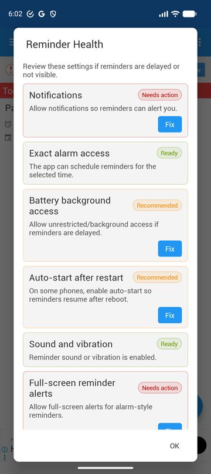
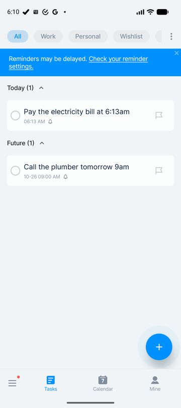

To Do Reminder with Alarm has a panel called **Reminder Health**, the same
name. Six checks (notifications, exact alarms, battery, auto-start, sound,
full-screen alerts), each with a Ready / Needs action badge and a Fix button,
offered right after the first save. To-Do List shows a dismissible "Reminders
may be delayed" banner that opens a static settings guide.

What neither does is the part D-058 added: telling the user whether a real
reminder was seen to arrive, and late by how much. To Do Reminder's panel did
not even notice notifications being granted; it still said Needs action.

So `play-listing.md` calling the health screen "the thing no competitor
screenshot has" is wrong as written. The checks are common. The evidence is
not. The listing and the screenshot should lead with "tells you afterwards if a
real reminder arrived late", which nobody walked here does.

## What the notification offers

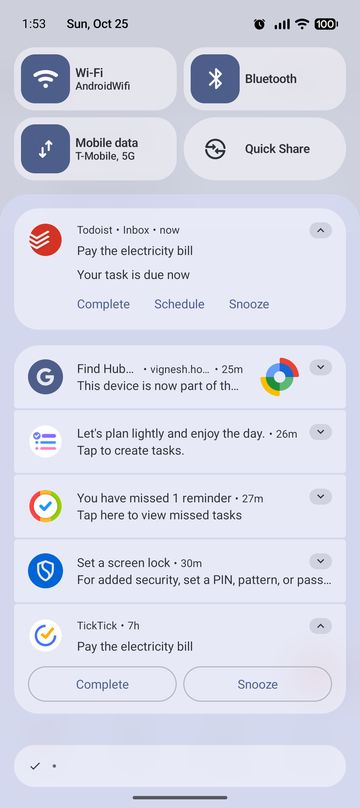
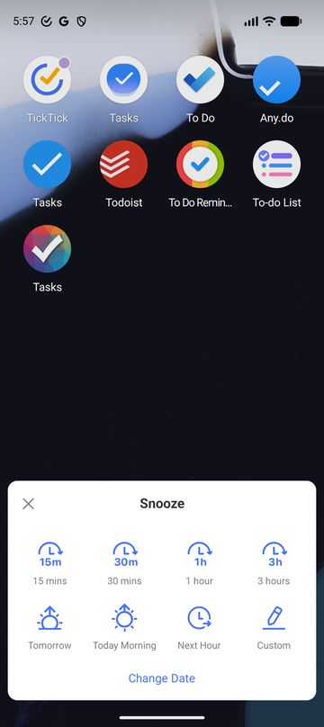
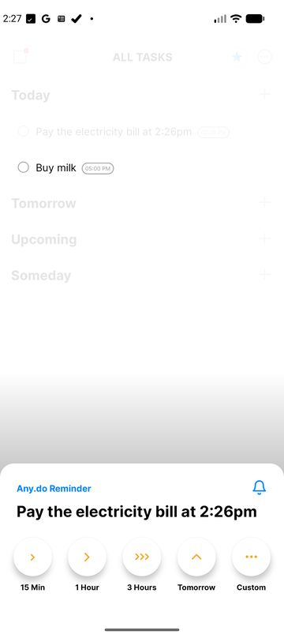

| App | Actions | Snooze |
|---|---|---|
| Tellcat | Done, Snooze | Two taps in the shade: 10 min, 1 hour, This evening, Tomorrow morning (D-078) |
| Google Tasks | Mark completed, Reschedule | None |
| TickTick | Complete, Snooze; cannot be swiped away | A floating sheet over whatever is open, 8 presets plus Custom and Change Date |
| Todoist | Complete, Schedule, Snooze | One tap, always 30 minutes, no feedback |
| Any.do | Snooze, Focus, Done; default importance, so no heads-up | Opens the app: 15 min, 1 hour, 3 hours, Tomorrow, Custom |
| To Do Reminder | None, "Tap here to view and edit task" | Repeats itself 5 minutes later |

Tellcat's choice holds up. Todoist's one-tap snooze is a guess the user cannot
see, which is the reason D-078 gave for two taps. Any.do's opens the app, which
is heavier than a shade action needs to be. TickTick's floating sheet is the
best-looking, but eight presets is a menu, not a choice.

The one gap is the third action. Google Tasks and Todoist both offer "move this
to another day" from the notification. Tellcat's Snooze, Tomorrow morning
covers the common case. Whether a reminder that is now pointless needs a
Reschedule button as well is a question to ask testers, not something to add.

## Rescheduling from the list

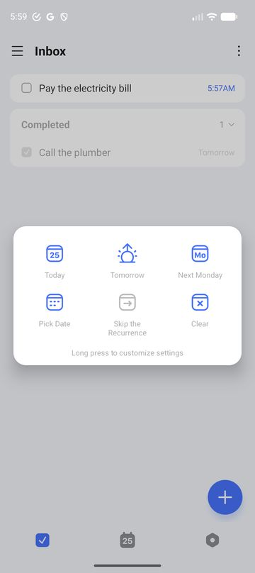
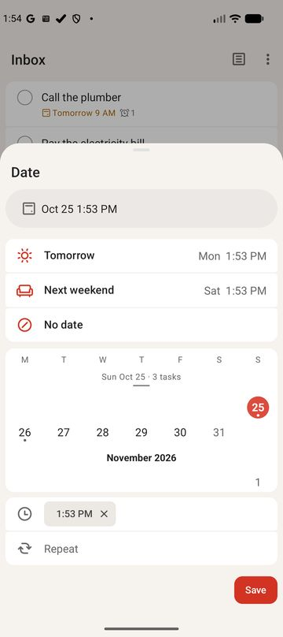
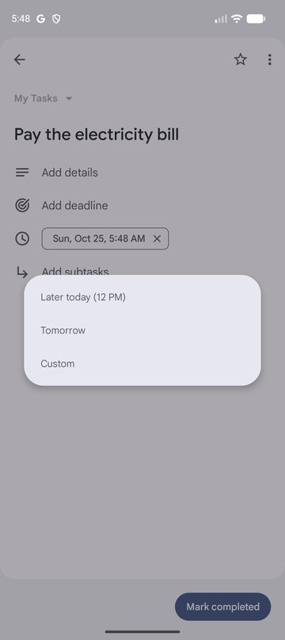

TickTick and Todoist both make "not today" two gestures from the list. TickTick:
swipe left, Date, Tomorrow. Todoist: swipe left, Tomorrow. Google Tasks has no
list gesture at all; the task has to be opened.

Todoist's sheet has two details worth copying whenever Tellcat's list
rescheduling is decided:

- Each preset shows its result with the task's own time kept: "Tomorrow, Mon
  1:53 PM", "Next weekend, Sat 1:53 PM". A user can see what will happen before
  tapping.
- The calendar strip shows how full each day is: "Sun Oct 25 · 3 tasks".

The list gesture itself is the open question already waiting on tester
feedback. This walk adds that the two apps with the most polish both put it on
a swipe.

## Capture

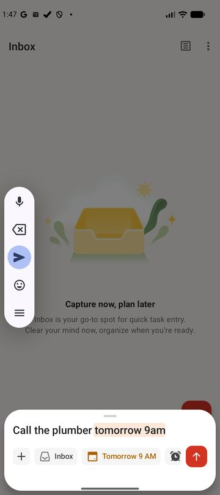
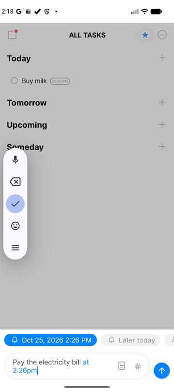

| App | Parses dates | Removes them from the title |
|---|---|---|
| Tellcat | Yes | Yes |
| TickTick | Yes | Yes |
| Todoist | Yes | Yes |
| Any.do | Yes | No: "Pay the electricity bill at 2:26pm" |
| To-Do List | Yes | No |
| Google Tasks, To Do Reminder, Pocket | No | |

Tellcat is with the best here, and its placeholder already teaches the grammar
("Try "Call the plumber tomorrow""), as Todoist's does ("e.g. Go to the library
Monday afternoon"). To-Do List teaches it with a first-time tip instead: "Tap
the word to cancel the recognition." Tellcat has no way to undo a wrong parse
except editing the text. Nobody in testing has asked for one yet.

Any.do's add box shows three reminder chips under the title: Later today, This
evening, Tomorrow morning. A reminder in one tap without typing a time. It
matches Tellcat's own snooze presets closely, which makes it a coherent idea.
It would be a change to Quick Add, so it needs a decision.

## Voice

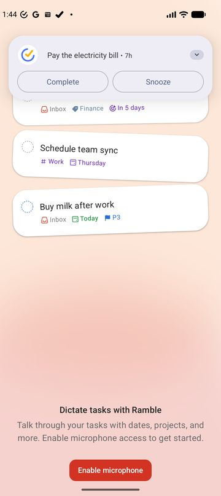

Todoist's onboarding leads with Ramble: "Talk through your tasks with dates,
projects, and more." Any.do and To Do Reminder put a mic on the add box. With
the tagline "Just tell it." (D-092), a competitor doing literal telling is
worth knowing about. D-070 was stage one: the parser reads what keyboard
dictation writes. The mic button is the later stage D-070 left open, and
D-092 already notes Tellcat makes no voice-assistant promise. Nothing here
changes that order.

## First run

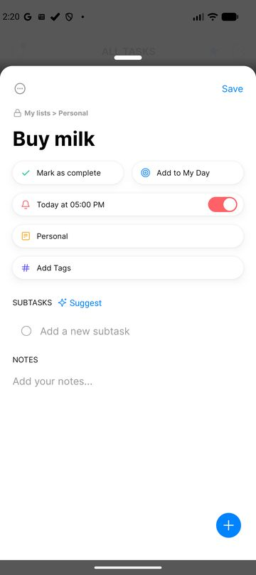

The apps with accounts spend the first minute on themselves:

- **Todoist:** a name form, a "how do you plan to use Todoist" survey, a
  "how do you manage tasks today" survey, a Ramble demo, digest opt-ins and an
  intro video.
- **Any.do:** a calendar-sync pitch and a plan picker. After the first save it
  pitched an unrelated missed-call feature that wanted notification access.
- **TickTick:** an AI assistant promo.
- **To-Do List:** a paywall with a Close that takes a couple of seconds to
  work.

To-Do List, Google Tasks and Pocket also ask for notification permission at
launch, before there is anything to notify about.

Tellcat asks at the first reminder (`ReminderPermission.kt`), as Todoist does.
Its onboarding is one screen. Both are right, and this walk is the evidence for
keeping them that way.

Two of these apps (To-Do List, Any.do) post a permanent "Add task" notification
in the shade. Tellcat should not. Its shade is for reminders.

## Smaller confirmations

- **Completing with undo.** Todoist shows "Completed. Undo" above the FAB,
  which is Tellcat's pattern. Google Tasks has no undo; the way back is the
  Completed section.
- **Complete in task details.** Google Tasks puts "Mark completed" at the
  bottom and Any.do puts "Mark as complete" as a button under the title. Neither
  puts a checkbox by the title. That fits D-093.
- **Someday.** Any.do's home is Today / Tomorrow / Upcoming / Someday. Tellcat
  cut Someday on evidence (D-002). Seeing it in a competitor is not a reason to
  bring it back.
- **Morning overview, Evening review.** Todoist offers both as opt-in
  notifications during setup, off by default. An idea, not a gap. A daily
  summary is not a reminder, and the product is about the moment a task
  matters.

## Ideas that would need a decision

In the order I would look at them:

1. Rewrite the Reminder health line in `play-listing.md` around arrival
   evidence. This is a listing fix, not product scope.
2. When list rescheduling is decided: show each preset's result with the
   task's time kept, and show how full each day is.
3. Reminder chips in Quick Add (Later today, This evening, Tomorrow morning),
   matching the snooze presets.
4. A Reschedule action on the notification, only if testers ask for it.
