# Competitor walk, October 2026

Eight Android task and reminder apps installed from Play on the Pixel 10
emulator and used the way a new user would, on 2026-10-24 and 2026-10-25. The
question was narrow: what do they do that would help Tellcat's users, and where
do they fail at the thing Tellcat promises.

This is research, not scope. Anything below that would change what Tellcat does
needs its own entry in `decisions.md` first, and several of the ideas run into
decisions already made. Those are named where they come up.

## The apps

| App | Installs | Account | Walked |
|---|---|---|---|
| Google Tasks | 10M+ | Google, already on the device | Yes |
| TickTick | 10M+ | Signed in by the owner | Yes |
| Todoist | 10M+ | Signed in by the owner with Google | Yes |
| Any.do | 10M+ | Signed in by the owner | Yes |
| To-Do List - Schedule Planner | 10M+ | None | Yes |
| To Do Reminder with Alarm | 5M+ | None | Yes |
| Tasks (Pocket Brilliance) | 5M+ | None | Yes, capture only |
| Tasks.org | 1M+ | None, but its first screen is a terms acceptance | No, terms not accepted |
| Microsoft To Do | 10M+ | Microsoft | Skipped at the owner's request |

Due is iPhone only.

## Reliability

Each app got a task with a time a few minutes ahead. The alarm the app
registered was read from `dumpsys alarm`, and the notification's post time from
`dumpsys notification`.

| App | Alarm | Due | Arrived | Verdict |
|---|---|---|---|---|
| Google Tasks | exact | 5:48 | 5:48:03 | On time |
| TickTick | exact | 5:57 | 5:57:04 | On time |
| Todoist | exact, window 0 | 13:53 | 13:53:00.2 | On time |
| Any.do | exact, window 0 | 14:26 | 14:26:03.7 | On time (the emulator was starved for CPU) |
| To Do Reminder | exact | 6:04 | 6:04:54 | 54 s late: the alarm keeps the seconds of the moment the task was made |
| To-Do List | inexact | 6:13 | never | **Missed, silently** |
| Todoist, second task | | 14:00 | never | **Missed, silently** |

The two misses have the same cause. To-Do List's default reminder is five
minutes before the due time. A task created at 6:10 for 6:13 had a reminder at
6:08, already gone, and the app dropped it without a word: the task still says
"Reminder at 06:08". Todoist's second task was typed for 2:00pm and saved at
about 2:01 because the emulator was lagging; it got no reminder, no
notification, and the row lost its alarm glyph.

Tellcat already refuses this. D-030 moves a time that has gone by to its next
occurrence and says so on the sheet before saving, and the scheduler clamps
anything late to now rather than skipping it. Two of seven apps silently
failing on a reminder a few minutes out is the strongest evidence this walk
produced for the product's premise.

Todoist also passed a harder case. A snoozed reminder whose task was then
rescheduled and completed still had its snooze alarm registered. It went off
and posted nothing. That is the right answer, and D-078's `snoozedUntil` makes
it Tellcat's too.

## Reminder health is not unique any more

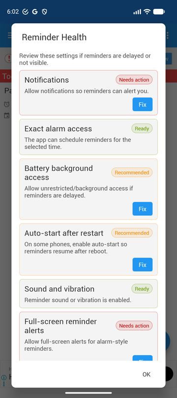
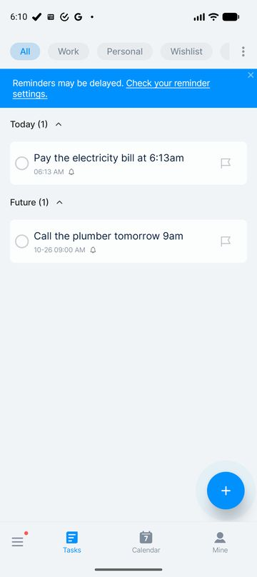

To Do Reminder with Alarm has a panel called **Reminder Health**, the same
name. Six checks (notifications, exact alarms, battery, auto-start, sound,
full-screen alerts), each with a Ready / Needs action badge and a Fix button,
offered right after the first save. To-Do List shows a dismissible "Reminders
may be delayed" banner that opens a static settings guide.

What neither does is the part D-058 added: telling the user whether a real
reminder was seen to arrive, and late by how much. To Do Reminder's panel did
not even notice notifications being granted; it still said Needs action.

So `play-listing.md` calling the health screen "the thing no competitor
screenshot has" is wrong as written. The checks are common. The evidence is
not. The listing and the screenshot should lead with "tells you afterwards if a
real reminder arrived late", which nobody walked here does.

## What the notification offers

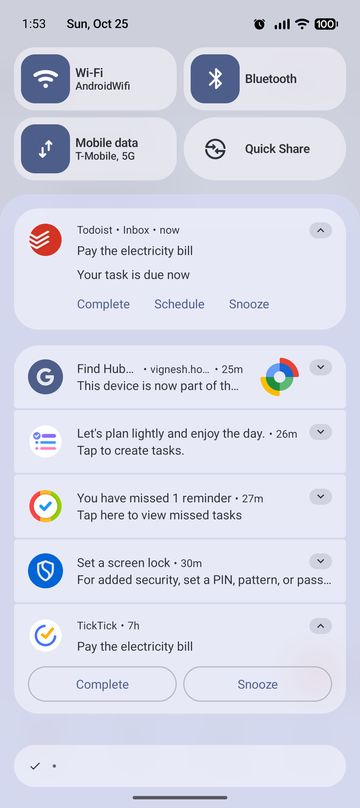
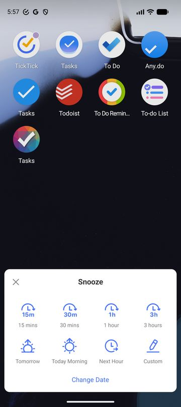
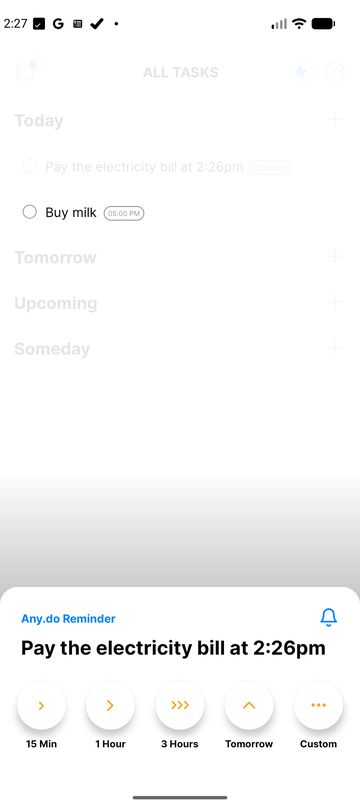

| App | Actions | Snooze |
|---|---|---|
| Tellcat | Done, Snooze | Two taps in the shade: 10 min, 1 hour, This evening, Tomorrow morning (D-078) |
| Google Tasks | Mark completed, Reschedule | None |
| TickTick | Complete, Snooze; cannot be swiped away | A floating sheet over whatever is open, 8 presets plus Custom and Change Date |
| Todoist | Complete, Schedule, Snooze | One tap, always 30 minutes, no feedback |
| Any.do | Snooze, Focus, Done; default importance, so no heads-up | Opens the app: 15 min, 1 hour, 3 hours, Tomorrow, Custom |
| To Do Reminder | None, "Tap here to view and edit task" | Repeats itself 5 minutes later |

Tellcat's choice holds up. Todoist's one-tap snooze is a guess the user cannot
see, which is the reason D-078 gave for two taps. Any.do's opens the app, which
is heavier than a shade action needs to be. TickTick's floating sheet is the
best-looking, but eight presets is a menu, not a choice.

The one gap is the third action. Google Tasks and Todoist both offer "move this
to another day" from the notification. Tellcat's Snooze, Tomorrow morning
covers the common case. Whether a reminder that is now pointless needs a
Reschedule button as well is a question to ask testers, not something to add.

## Rescheduling from the list

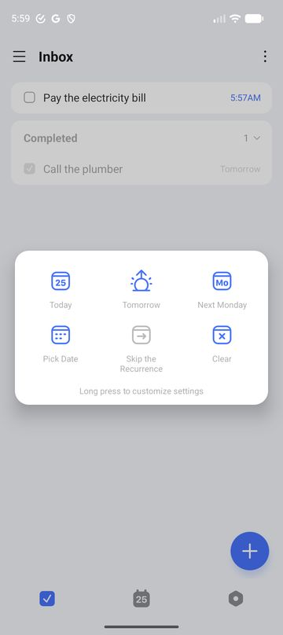
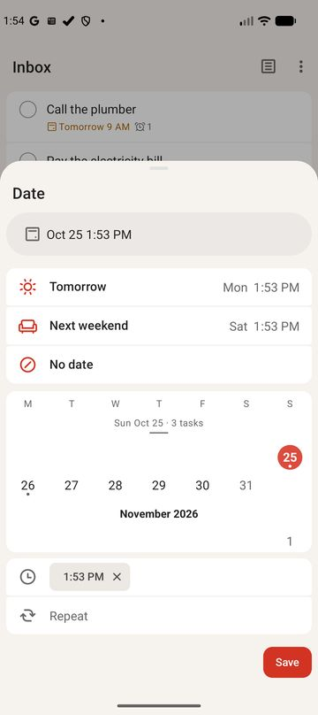
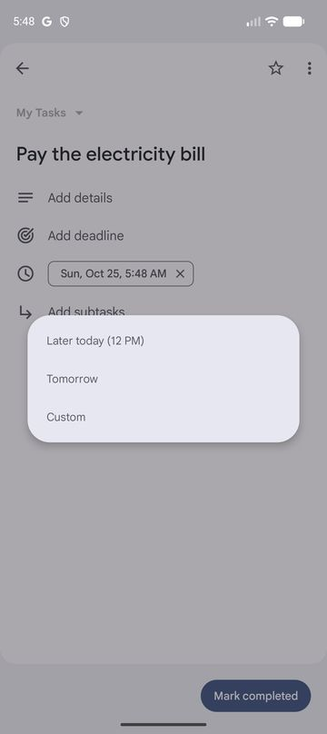

TickTick and Todoist both make "not today" two gestures from the list. TickTick:
swipe left, Date, Tomorrow. Todoist: swipe left, Tomorrow. Google Tasks has no
list gesture at all; the task has to be opened.

Todoist's sheet has two details worth copying whenever Tellcat's list
rescheduling is decided:

- Each preset shows its result with the task's own time kept: "Tomorrow, Mon
  1:53 PM", "Next weekend, Sat 1:53 PM". A user can see what will happen before
  tapping.
- The calendar strip shows how full each day is: "Sun Oct 25 · 3 tasks".

The list gesture itself is the open question already waiting on tester
feedback. This walk adds that the two apps with the most polish both put it on
a swipe.

## Capture

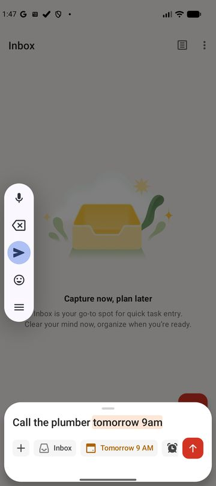
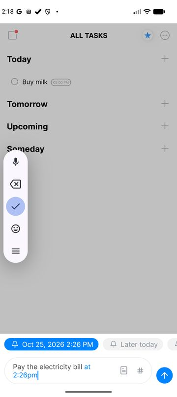

| App | Parses dates | Removes them from the title |
|---|---|---|
| Tellcat | Yes | Yes |
| TickTick | Yes | Yes |
| Todoist | Yes | Yes |
| Any.do | Yes | No: "Pay the electricity bill at 2:26pm" |
| To-Do List | Yes | No |
| Google Tasks, To Do Reminder, Pocket | No | |

Tellcat is with the best here, and its placeholder already teaches the grammar
("Try "Call the plumber tomorrow""), as Todoist's does ("e.g. Go to the library
Monday afternoon"). To-Do List teaches it with a first-time tip instead: "Tap
the word to cancel the recognition." Tellcat has no way to undo a wrong parse
except editing the text. Nobody in testing has asked for one yet.

Any.do's add box shows three reminder chips under the title: Later today, This
evening, Tomorrow morning. A reminder in one tap without typing a time. It
matches Tellcat's own snooze presets closely, which makes it a coherent idea.
It would be a change to Quick Add, so it needs a decision.

## Voice

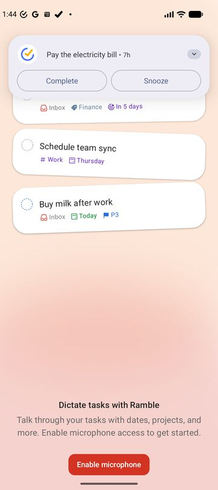

Todoist's onboarding leads with Ramble: "Talk through your tasks with dates,
projects, and more." Any.do and To Do Reminder put a mic on the add box. With
the tagline "Just tell it." (D-092), a competitor doing literal telling is
worth knowing about. D-070 was stage one: the parser reads what keyboard
dictation writes. The mic button is the later stage D-070 left open, and
D-092 already notes Tellcat makes no voice-assistant promise. Nothing here
changes that order.

## First run

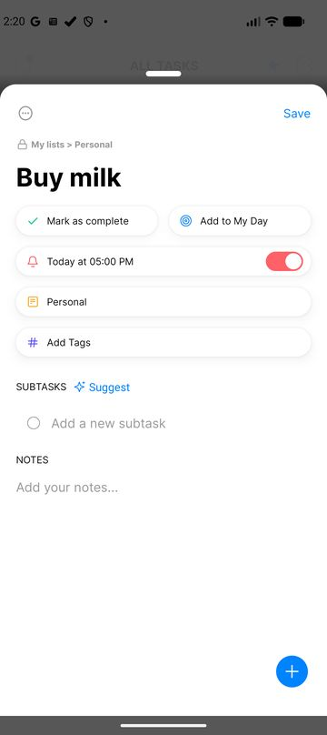

The apps with accounts spend the first minute on themselves:

- **Todoist:** a name form, a "how do you plan to use Todoist" survey, a
  "how do you manage tasks today" survey, a Ramble demo, digest opt-ins and an
  intro video.
- **Any.do:** a calendar-sync pitch and a plan picker. After the first save it
  pitched an unrelated missed-call feature that wanted notification access.
- **TickTick:** an AI assistant promo.
- **To-Do List:** a paywall with a Close that takes a couple of seconds to
  work.

To-Do List, Google Tasks and Pocket also ask for notification permission at
launch, before there is anything to notify about.

Tellcat asks at the first reminder (`ReminderPermission.kt`), as Todoist does.
Its onboarding is one screen. Both are right, and this walk is the evidence for
keeping them that way.

Two of these apps (To-Do List, Any.do) post a permanent "Add task" notification
in the shade. Tellcat should not. Its shade is for reminders.

## Smaller confirmations

- **Completing with undo.** Todoist shows "Completed. Undo" above the FAB,
  which is Tellcat's pattern. Google Tasks has no undo; the way back is the
  Completed section.
- **Complete in task details.** Google Tasks puts "Mark completed" at the
  bottom and Any.do puts "Mark as complete" as a button under the title. Neither
  puts a checkbox by the title. That fits D-093.
- **Someday.** Any.do's home is Today / Tomorrow / Upcoming / Someday. Tellcat
  cut Someday on evidence (D-002). Seeing it in a competitor is not a reason to
  bring it back.
- **Morning overview, Evening review.** Todoist offers both as opt-in
  notifications during setup, off by default. An idea, not a gap. A daily
  summary is not a reminder, and the product is about the moment a task
  matters.

## Ideas that would need a decision

In the order I would look at them:

1. Rewrite the Reminder health line in `play-listing.md` around arrival
   evidence. This is a listing fix, not product scope.
2. When list rescheduling is decided: show each preset's result with the
   task's time kept, and show how full each day is.
3. Reminder chips in Quick Add (Later today, This evening, Tomorrow morning),
   matching the snooze presets.
4. A Reschedule action on the notification, only if testers ask for it.

## Adding a task in TickTick, 2026-11-02

TickTick 8.2.2.0 on the Pixel 10 emulator, signed in by the owner, walked with
a made-up task ("Pay rent friday at 9am"), which was deleted afterwards. The
question was D-121's: what does its add sheet do that Tellcat should take, and
what should it not.

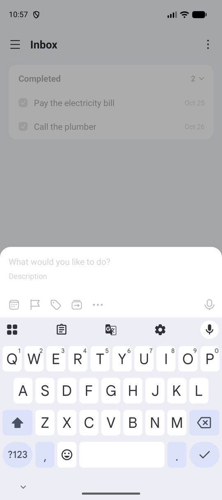
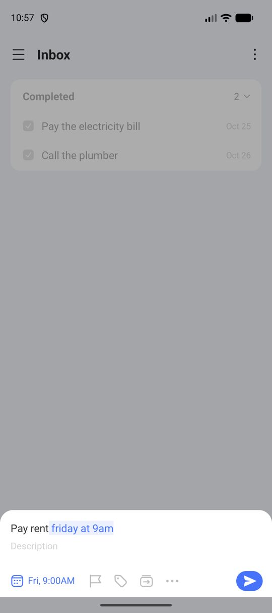
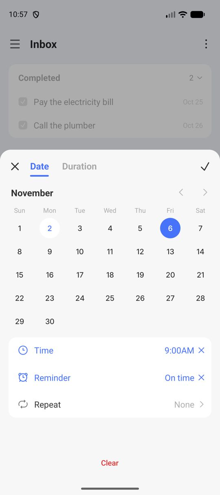
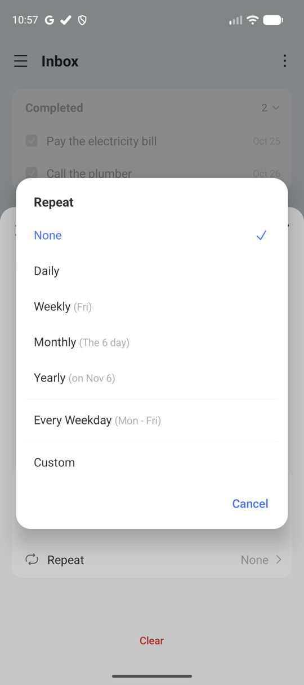
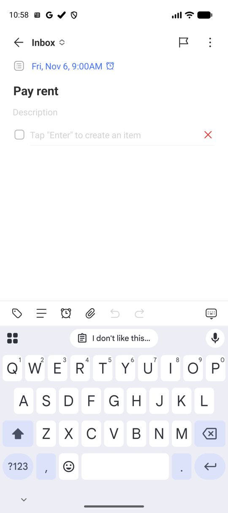

**The sheet.** A title field ("What would you like to do?"), a Description
field, and one row of icons on the keyboard: date, priority, tags, list, and a
"more" menu, with a microphone at the end that becomes a send button once there
is a title.

**Worth taking.**

- **A set tool shows its value in place.** Typing "friday at 9am" marks the
  words in the title, and the date icon in the row becomes "Fri, 9:00AM". There
  is no separate row of chips, so nothing above the keyboard grows as tools are
  set.
- **One tool for when.** The date icon opens one sheet: a month calendar where
  one tap picks the day, then Time, Reminder and Repeat rows, and a confirm
  tick. Tellcat's reminder sheet already took the Day-row-and-Time-row shape
  from here (see the reminder sheet decision).
- **Repeat is a list of the common rules, labelled from the chosen day**:
  Daily, Weekly (Fri), Monthly (the 6th), Yearly (on Nov 6), Every Weekday, and
  Custom for the rest. Daily is one tap. In Tellcat it is Every, Day, Done, Save
  repeat.
- **The empty checklist line teaches itself**: its hint reads "Tap 'Enter' to
  create an item".

**Not worth taking.**

- **The checklist is not in the add sheet.** It is More, Full-Screen, then the
  list icon, which leaves the sheet for the full editor. The owner's ask, a
  checklist in the add sheet, goes further than TickTick does.
- **Repeat opens as a dialog over the date sheet**: two windows, two scrims,
  which D-026 refuses for Tellcat's sheets.
- **"Monthly (The 6 day)"**: the wording is broken.
- **The keyboard did not come back** after the date sheet closed; the title had
  to be tapped again. D-112 already requires Tellcat to return it.
- **Priority, tags and lists** are in the row. Tellcat has none of them, by
  decision.
- A "give us five stars" card appeared in the list after the first task.

## Adding from an Upcoming view, 2026-11-02

The owner asked whether Upcoming should get an add button. Todoist, TickTick
and Any.do on the Pixel 10 emulator, each add sheet opened and closed without
saving; Things 3 and Apple Reminders from their documentation, since neither
runs there. Microsoft To Do skipped, as in October.

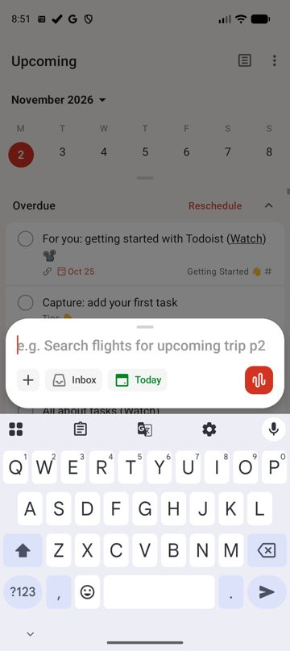
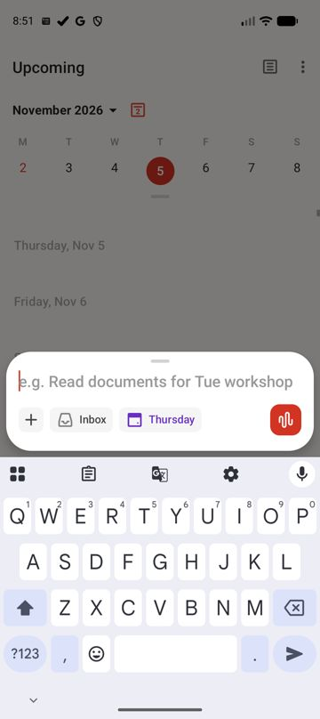
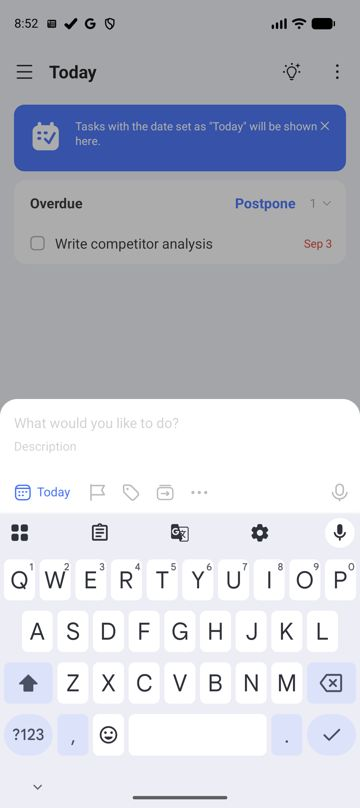
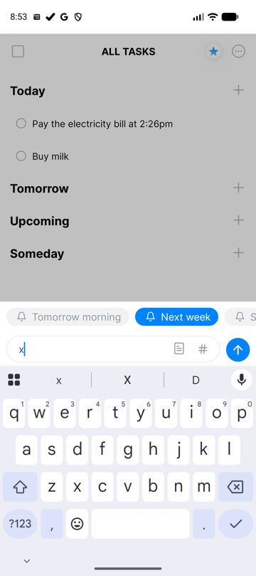

| App | Add on its Upcoming view | The day a new task gets |
|---|---|---|
| Todoist | Yes, the same button as everywhere | The day selected in Upcoming's week strip, shown as a chip; or drag the button onto a day |
| TickTick | Yes, on every list | From Today, a Today chip. Its Tomorrow and Next 7 Days lists were off on this account and were not turned on |
| Any.do | A plus beside each section | Upcoming's plus chooses Next week |
| Things 3 | Its Magic Plus, on every list | Dropped onto a day in Upcoming, that day; a plain tap is not documented |
| Apple Reminders | A Scheduled view | Not confirmed from Apple's documentation |

**What it shows.** Every one of them adds to what the user is looking at and
says the day in the sheet before saving, as a chip that can be changed. A
default nobody can see is the confusing kind; none of them has one. Tellcat's
Today and Inbox follow the same rule through the line under the field.

**Why Tellcat's Upcoming still has none.** Todoist's rule works because its
Upcoming has a selected day. Tellcat's has none, so any default is a guess, and
Any.do's "Next week" is what that guess looks like. The owner kept Upcoming
without a button. If Upcoming is ever meant for planning, Todoist's selected
day is the model, and that is a change to Upcoming rather than a button.

Sources: [Todoist, Upcoming view](https://www.todoist.com/help/articles/plan-your-week-with-the-upcoming-view-OKOg1mR8),
[Things, Magic Plus](https://culturedcode.com/things/features/),
[Things, Today, Upcoming, Anytime and Someday](https://culturedcode.com/things/support/articles/4001304/).

## Candidates to pick up, 2026-11-02

The owner asked what Tellcat should take from these apps to be the one with no
alternative. These are the answers, in the order to pick them up. **None is
decided.** Each needs its own entry in `decisions.md`, and the owner's word,
before it is built, and none is current-phase work until `ROADMAP.md` says so.
Take them one at a time; mark each here when it is decided, built or dropped.

The yardstick is Things 3: fewer features than Todoist, every one of them
considered. Depth on the loop (capture, say when, be told, complete), not
breadth.

### 1. Move everything overdue to today, in one tap

- **Seen in:** Todoist ("Reschedule" on the Overdue header), TickTick
  ("Postpone" on the same header), both on 2026-11-02.
- **For Tellcat:** a "Move all to today" action on Today's Overdue band, with
  Undo. Today is meant to answer "what should I do now?" in seconds, and a pile
  of overdue rows that can only be moved one at a time is in the way of that.
- **To settle in the decision:** what happens to each task's reminder time,
  and to a repeating task's series day (D-122).
- **Status:** not decided.

### 2. Reschedule from the list with a swipe

- **Seen in:** TickTick (swipe left, Date, Tomorrow), Todoist (swipe left,
  Tomorrow), October walk.
- **For Tellcat:** today a task has to be opened to move it. Take Todoist's
  two details with it: each choice shows its result with the task's own time
  kept ("Tomorrow, Tue 9:00 AM"), so the user sees what happens before tapping.
  Task Details stays the other route, so the swipe is never the only one.
- **Touches:** D-023, which removed the row's long press and trailing button.
  The question has waited on tester feedback since October.
- **Status:** not decided.

### 3. Show how full each day is when picking a date

- **Seen in:** Todoist's calendar strip, "Sun Oct 25 · 3 tasks".
- **For Tellcat:** a small mark under days that already hold tasks in Choose a
  date. Picking a day without knowing it is packed is how plans fail.
- **Status:** not decided.

### 4. One-tap times in the When sheet

- **Seen in:** Any.do's add box: Later today, This evening, Tomorrow morning.
- **For Tellcat:** the same words Tellcat already uses for snooze (D-078), as
  presets in Quick Add's When sheet (D-121), so most reminders never need the
  time picker.
- **Status:** not decided. Listed in October as idea 3.

### 5. Add without opening the app

- **Seen in:** Things' Quick Entry on the Mac; standard Android practice.
- **For Tellcat:** a "New task" launcher shortcut on a long press of the icon,
  and a Quick Settings tile. Tellcat has neither (checked 2026-11-02). Both are
  Android conventions, which `PRODUCT.md` principle 5 asks for, and both serve
  "capture should be effortless".
- **Status:** not decided.

### 6. Say it out loud

- **Seen in:** Todoist's Ramble, which leads its onboarding; a mic on Any.do's
  and To Do Reminder's add box.
- **For Tellcat:** a mic in Quick Add using Android's own speech recognizer,
  the later stage D-070 left open, and the literal form of "Just tell it."
  (D-092).
- **To settle in the decision:** whether the system recognizer falls under
  "AI features", which `PRODUCT.md` puts out of scope.
- **Status:** not decided. After 1.x.

### 7. Remind me when I get somewhere

- **Seen in:** Apple Reminders ("when I arrive home").
- **For Tellcat:** the one feature in these apps that strengthens the promise
  itself, since a place can be "the moment it matters". It is also hard to make
  reliable on Android, and reliability is the bar every reminder is held to.
- **Status:** not decided. Post-1.0, and a decision of its own.

### Not to take

Already decided against, or seen to make an app worse:

- Priorities, tags and projects (D-003), Someday (D-002), streaks and scores
  (`PRODUCT.md` principle 7), AI assistants, accounts and sync.
- Surveys and paywalls before the first task (Todoist, To-Do List).
- A permanent "Add task" notification (To-Do List, Any.do).
- An eight-option snooze menu (TickTick), and a one-tap snooze whose time
  cannot be seen (Todoist).

### The part that is not a feature

What makes an app feel like it has no alternative is mostly what no list
names: nothing moves while the user types, one rule per behaviour, every state
in words, 200% text that is really tested, a fast start, and a reminder that
can be shown to have arrived. Reminder health's arrival evidence is the one
thing no competitor here has. The proposal is a standing polish pass before
each release: cold start and dropped frames measured, every screen at 200%,
TalkBack listened to on a device.
